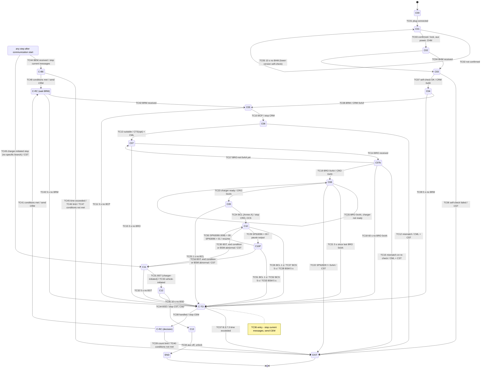
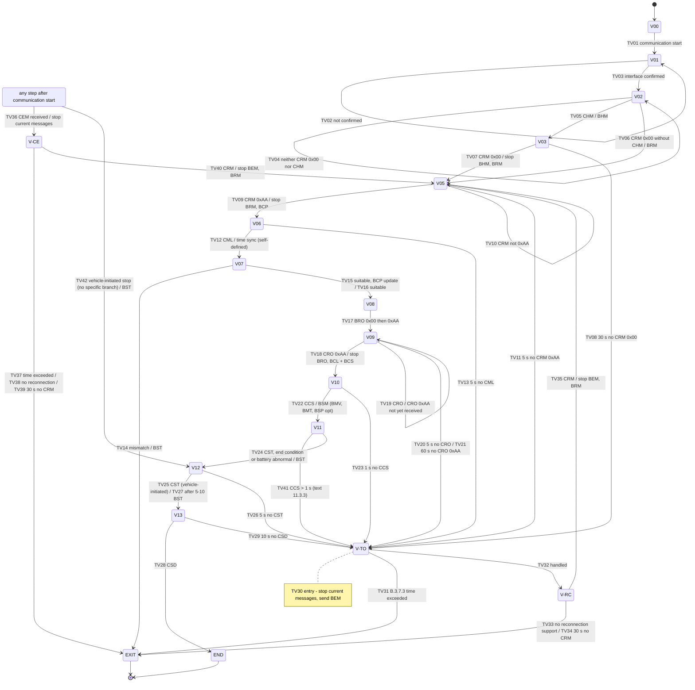

# PHASE 01.2 — A-System State Machines (Charger and Vehicle)

## Document Control

| Field | Value |
|---|---|
| Project | GB/T 27930-2023 System A Charger-BMS Simulator |
| Phase | PHASE 01.2 — A-System Protocol Reconstruction |
| Document | 01.2_STATE_MACHINES.md |
| Status | DRAFT — Owner review accepted for current PHASE 01 working use. Final PHASE 01 freeze remains pending the PHASE 01 Exit Review. |
| Acceptance note | The Project Owner accepted the PHASE 01.2 deliverables as input to PHASE 01.3, with unresolved questions preserved (PHASE 01.3 R1 authorization). Open questions in this document remain OPEN unless a status note states otherwise; current dispositions are maintained in `docs/REQUIREMENTS_BASELINE.md` §6.4–§6.5. |
| Revision note | 2026-11-09, PHASE 01.4-B B3-B: acceptance metadata and decision status note added (OQ-S10). No transition, state, state-machine behaviour or timeout value changed. |
| Date | 2026-11-08 |
| Companion documents | 01.2_PROTOCOL_TABLES.md, 01.2_TIMEOUT_TABLE.md |

Evidence-based working draft, not an approved baseline. Not filled from
`PROJECT_1_SPEC_v2.0.txt` or GB/T 27930-2015.

## Source Standard

GB/T 27930-2023, `reference/standards/GBT+27930-2023.pdf`, SHA-256
`f9eb420ee3bd8b2ba3640e1830bc1b2011433e024bbdda585d01cecc2e7992a6`
(verified before use). Page references: printed page (p.) / PDF index
(pdf); pdf = p. + 4. All flowchart content was read from 2× page
renderings; see 01.2_PROTOCOL_TABLES.md "Method".

## Scope

- Normative flow: Annex A, Figure A.1 (normal charging, pp. 47–53 /
  pdf 51–57, notes a–l on p.52–53), Figure A.2 (charger reception
  timeout handling, p.54 / pdf 58), Figure A.3 (vehicle reception timeout
  handling, p.55 / pdf 59).
- Supporting text: Chapters 9–11 (message functions), Annex B Table B.1.
- A-system only.

## Important: What the Standard Does and Does Not Define

- The standard defines the process as **flowcharts** of activities
  ("send X periodically"), decisions and timeouts. It defines **no named
  states and no state identifiers**.
- The step labels below (`C00` … for the charger, `V00` … for the
  vehicle) are **document-local labels** for flowchart positions,
  introduced only to make transitions referable. They are not standard
  identifiers and are not the project's earlier state names (IDLE,
  C_CONFIG, C_CHARGING, FAULT_LOCAL, …), which do not appear in the
  standard and are not mapped here.
- "Exit charging" (退出充电) and "charging end" (充电结束) are the
  standard's terminal outcomes.

---

## 1. Charger State Machine

### 1.1 Steps (document-local labels)

| Label | Flowchart position / activity | Messages sent | Page |
|---|---|---|---|
| C00 | Vehicle plug–socket connection | — | p.47 / pdf 51 |
| C01 | Wait for vehicle interface connection confirmation | — | p.47 / pdf 51 |
| C02 | Electronic lock locked; low-voltage auxiliary power circuit closed; send CHM periodically (first CHM within 1 s, note a); wait for BHM | CHM | p.47 / pdf 51 |
| C03 | Charger self-check (note c) | CHM | p.48 / pdf 52 |
| C04 | Stop CHM; send CRM (SPN2560=0x00); wait for BRM | CRM 0x00 | p.48 / pdf 52 |
| C05 | CRM data change (SPN2560=0xAA); wait for BCP | CRM 0xAA | p.48 / pdf 52 |
| C06 | Stop CRM; check whether vehicle parameters are suitable (note d) | — | p.48 / pdf 52 |
| C07 | Send CTS (optional) and CML periodically; wait for BRO | CTS (opt.), CML | p.49 / pdf 53 |
| C07b | On BRO: re-check vehicle parameters with the last BCP (note g); wait for BRO (SPN2829=0xAA) | CTS (opt.), CML | p.49 / pdf 53 |
| C08 | Stop CTS/CML; send CRO (SPN2830=0x00); check BRO status and own readiness | CRO 0x00 | p.49–50 / pdf 53–54 |
| C09 | CRO data change (SPN2830=0xAA); wait for BCL | CRO 0xAA | p.50 / pdf 54 |
| C10 | Charging: stop CRO; send CCS periodically; output on demand; monitor BCL, BCS, BSM | CCS | p.50–51 / pdf 54–55 |
| C10P | Charging pause (BSM SPN3096=0x00): output paused; CCS continues (the pause box returns to "按周期发送CCS报文" in Fig. A.1); BCL/BCS/BSM monitoring continues (TC51–TC53); stop handling TC54; resume TC50. CCS SPN3929 = 00 during pause is a project interpretation of the Table 19 note | CCS | p.51 / pdf 55; §11.3.4, p.15–16 / pdf 19–20 |
| C11 | Send CST periodically; (if charger-initiated) wait for BST | CST | p.51–52 / pdf 55–56 |
| C12 | Wait for BSD (note l) | CST | p.52 / pdf 56 |
| C13 | Stop CST; send CSD periodically; low-voltage auxiliary power off; electronic lock unlocked | CSD | p.52 / pdf 56 |
| C-TO | Charger reception timeout handling (Fig. A.2) | CEM | p.54 / pdf 58 |
| C-BE | Handling of a vehicle-reported timeout (BEM received; Fig. A.3, charger side) | — | p.55 / pdf 59 |
| C-RC | Reconnection decision and CRM re-send (Fig. A.2/A.3); after CRM is sent, the sub-position "C-RC (wait BRM)" waits for BRM | CRM | p.54–55 / pdf 58–59 |
| EXIT | 退出充电 (exit charging) | — | various |
| END | Charging end on the charger side (after CSD, power off, unlock) | — | p.52 / pdf 56 |

### 1.2 Transitions

| ID | From | Trigger / guard | Action | To | Reference |
|---|---|---|---|---|---|
| TC01 | C00 | Plug–socket connected | — | C01 | Fig. A.1, p.47 / pdf 51 |
| TC02 | C01 | Interface connection not confirmed | Keep checking | C01 | Fig. A.1, p.47 |
| TC03 | C01 | Interface connection confirmed | Lock electronic lock; close low-voltage auxiliary power; start CHM (first within 1 s) | C02 | Fig. A.1, p.47; note a, p.52; §11.1.1, p.9 |
| TC04 | C02 | BHM received | Self-check per GB/T 18487.1—2023 B.4.3 (note c) | C03 | Fig. A.1, p.47; note c, p.52 |
| TC05 | C02 | No BHM within 10 s of the first CHM | Continue; self-check per the compatible lower version's method (note c) | C03 | Fig. A.1, p.47; note c, p.52 |
| TC06 | C03 | Self-check failed | Send CST (self-check fault) | EXIT | Fig. A.1, p.48 / pdf 52; §10.1, p.7 |
| TC07 | C03 | Self-check successful | Stop CHM; send CRM (SPN2560=0x00) | C04 | Fig. A.1, p.48; §11.1.3, p.10 |
| TC08 | C04 | BRM received | Change CRM to SPN2560=0xAA | C05 | Fig. A.1, p.48; §11.1.3, p.10 |
| TC09 | C04 | No BRM within 5 s of the first CRM | — | C-TO | Fig. A.1, p.48 |
| TC10 | C05 | BCP received | Stop CRM | C06 | Fig. A.1, p.48; Table B.1, p.56 |
| TC11 | C05 | No BCP within 5 s of sending CRM (0xAA) | — | C-TO | Fig. A.1, p.48 |
| TC12 | C06 | Vehicle parameters not suitable | Send CML and CST (charging parameters mismatch) | EXIT | Fig. A.1, p.48; §10.2, p.8 |
| TC13 | C06 | Vehicle parameters suitable | Send CTS (optional) and CML periodically | C07 | Fig. A.1, p.48–49 |
| TC14 | C07 | BRO received | — | C07b | Fig. A.1, p.49 / pdf 53 |
| TC15 | C07 | No BRO within 5 s of the first CML | — | C-TO | Fig. A.1, p.49; §11.2.4, p.13 |
| TC16 | C07b | Parameters not suitable on re-check with the last BCP | Send CML and CST (charging parameters mismatch) | EXIT | Fig. A.1, p.49; note g, p.53 |
| TC17 | C07b | Parameters suitable, BRO (0xAA) not yet received | Continue CTS/CML | C07 | Fig. A.1, p.49 |
| TC18 | C07b | No BRO (SPN2829=0xAA) within 60 s of the first CML | — | C-TO | Fig. A.1, p.49; §11.2.4, p.13 |
| TC19 | C07b | BRO (SPN2829=0xAA) received | Stop CTS/CML; send CRO (SPN2830=0x00) | C08 | Fig. A.1, p.49; §11.2.5, p.13 |
| TC20 | C08 | BRO received, SPN2829=0xAA, charger not ready | Continue CRO 0x00 | C08 | Fig. A.1, p.50 / pdf 54 |
| TC21 | C08 | No BRO within 5 s of the last BRO (SPN2829=0xAA) received | — | C-TO | Fig. A.1, p.50 |
| TC22 | C08 | BRO received with SPN2829 ≠ 0xAA | Send CST (pre-charge error) | EXIT | Fig. A.1, p.50 |
| TC23 | C08 | Charger ready | Change CRO to SPN2830=0xAA | C09 | Fig. A.1, p.50; §11.2.5, p.13 |
| TC24 | C09 | BCL received | Stop CRO; send CCS periodically; output on demand | C10 | Fig. A.1, p.50 / pdf 54 (normative). Working interpretation follows Annex A; informative Table B.1 (p.56 / pdf 60) states "BCL and BCS" — unresolved, OQ-S2 |
| TC25 | C09 | No BCL within 1 s of the first CRO (SPN2830=0xAA) | — | C-TO | Fig. A.1, p.50 |
| TC26 | C10 | No BCL within 1 s of the last BCL | — | C-TO | Fig. A.1, p.51 / pdf 55; §11.3.1, p.14 |
| TC27 | C10 | No BCS within 5 s of the last BCS | — | C-TO | Fig. A.1, p.51; §11.3.2, p.14 |
| TC28 | C10 | No BSM within 5 s of the last BSM (only after the first BSM; note h) | — | C-TO | Fig. A.1, p.51; note h, p.53; §11.3.4, p.15. Whether reconnection is permitted afterwards is **unresolved** (OQ-S1; 01.2_TIMEOUT_TABLE.md TO-16, OQ-T1) |
| TC29 | C10 | BSM SPN3096=0x00 (SPN3090–3095 all 00) | Pause output | C10P | Fig. A.1, p.51 (decision draws SPN3096 only); §11.3.4, p.16 / pdf 20 (adds SPN3090–3095 all 00) |
| TC30 | C10 | BST received, or charger end condition met (note i), or any of SPN3090–3095 abnormal | Send CST periodically | C11 | Fig. A.1, p.51; note i, p.53; §11.3.4, p.16 |
| TC31 | C11 | Charger-initiated stop and BST received | — | C12 | Fig. A.1, p.52 / pdf 56; note l, p.53 |
| TC32 | C11 | Charger-initiated stop, no BST within 5 s of the first CST | — | C-TO | Fig. A.1, p.52 |
| TC33 | C11 | Not charger-initiated (stop caused by BST) | — | C12 | Fig. A.1, p.52; note l, p.53 |
| TC34 | C12 | BSD received | Stop CST; send CSD; switch off low-voltage auxiliary power; unlock electronic lock | C13 → END | Fig. A.1, p.52; Table B.1, p.56–57 |
| TC35 | C12 | No BSD within 10 s of the first CST | — | C-TO | Fig. A.1, p.52 |
| TC36 | C-TO | Entry (communication timeout occurred) | Stop current messages; send CEM periodically | C-TO | Fig. A.2, p.54 / pdf 58; §10.5, p.9 |
| TC37 | C-TO | Timeout handling not completed within the time of GB/T 18487.1—2023 B.3.7.3 | — | EXIT | Fig. A.2, p.54 |
| TC38 | C-TO | Timeout handling completed | Stop CEM | C-RC | Fig. A.2, p.54 |
| TC39 | C-RC | Reconnection count limit reached (count set by the operator, note a) | — | EXIT | Fig. A.2, p.54 |
| TC40 | C-RC | Reconnection conditions not met (note b: GB/T 18487.1—2023 B.4.7.4; timed-out message is BCP, BRO, BCL, BCS or BSM) | — | EXIT | Fig. A.2, p.54. The inclusion of BSM conflicts with §11.3.4 and note h — **unresolved** (OQ-S1) |
| TC41 | C-RC | Reconnection conditions met | Send CRM periodically (subsequent flow per Fig. A.1, note c) | C-RC (wait BRM) | Fig. A.2, p.54 |
| TC42 | C-RC (wait BRM) | BRM received | Continue per Fig. A.1 | C05 path (Fig. A.1) | Fig. A.2, p.54, note c |
| TC43 | C-RC (wait BRM) | No BRM within 5 s of sending CRM | Communication timeout handling | C-TO | Fig. A.2, p.54; Fig. A.3, p.55 |
| TC44 | any charger step after communication start | BEM received | Stop current messages | C-BE | Fig. A.3, p.55 / pdf 59 |
| TC45 | C-BE | Timeout handling not completed within the time of B.3.7.3 | — | EXIT | Fig. A.3, p.55 |
| TC46 | C-BE | Completed; reconnection count limit reached (note a) | — | EXIT | Fig. A.3, p.55 |
| TC47 | C-BE | Completed; reconnection conditions not met (note b: B.4.7.3; vehicle timed-out message is CML, CRO or CCS) | — | EXIT | Fig. A.3, p.55 |
| TC48 | C-BE | Completed; conditions met | Send CRM periodically | C-RC (wait BRM) | Fig. A.3, p.55 |
| TC49 | any step after CHM has been sent | Abnormality or fault requiring a stop (charger-initiated) **not covered by a specific Annex A branch of the current step** (precedence: §1.4) | Send CST periodically (exactly one stop reason) | C11 | §11.3.9, p.19 / pdf 23; precedence is a project interpretation |
| TC50 | C10P | BSM received with SPN3090–3095 all 00 and SPN3096=01 | Resume output on demand | C10 | §11.3.4, p.16 / pdf 20 ("…SPN3096 为 01(允许充电)时,充电机恢复充电"). Pause duration limit: TM-03; consequence of exceeding it not defined here (OQ-S6) |
| TC51 | C10P | No BCL within 1 s of the last BCL | — | C-TO | Fig. A.1, p.50–51 / pdf 54–55 (pause path re-enters the monitoring loop); §11.3.1, p.14 |
| TC52 | C10P | No BCS within 5 s of the last BCS | — | C-TO | Fig. A.1, p.50–51 (loop as TC51); §11.3.2, p.14 |
| TC53 | C10P | No BSM within 5 s of the last BSM | — | C-TO | Fig. A.1, p.51 (loop as TC51); note h, p.53; §11.3.4, p.15. Reconnection afterwards **unresolved** as for TC28 (OQ-S1) |
| TC54 | C10P | BST received, or charger end condition met (note i), or any of SPN3090–3095 abnormal | Send CST periodically | C11 | §11.3.4, p.16 / pdf 20 (BST / abnormal BSM → CST, no pause exception); §11.3.9, p.19 / pdf 23; note i, p.53. Fig. A.1 does not reach the BST / end-condition decision while SPN3096 stays 0x00 — OQ-S11 |

### 1.3 Charger diagram (derived visualization of 1.2)

Every transition of §1.2 appears below, labelled with its ID. TC36 is
the entry action of C-TO (shown as a note). `ANYC` stands for "any step
after communication start / after CHM has been sent" (TC44, TC49).
`CRCW` is the "C-RC (wait BRM)" sub-position reached by TC41 and TC48, so
that TC39/TC40 are not re-evaluated after CRM has been sent.

### 1.4 Transition precedence (project interpretation)

The standard does not state an ordering between its specific flowchart
branches and the general stop permission of §11.3.9. To avoid ambiguous
simultaneous transitions, this draft applies the following **project
interpretation** (not a quotation of the standard):

1. Where Annex A draws a specific branch for a condition in the current
   step, that branch is taken and the generic transition TC49 is not:
   self-check failure (TC06), parameter mismatch (TC12, TC16) and
   BRO SPN2829 ≠ 0xAA (TC22) end in EXIT as drawn.
2. In C10 (charging), stop conditions are handled by TC30 as drawn in
   Fig. A.1; TC49 applies in C10 only to a charger fault that is not a
   TC30 condition, and then leads to the same step C11. If several C10
   conditions hold in the same evaluation, they are taken in the order
   in which Fig. A.1 draws the checks (p.51 / pdf 55): BCL timeout
   (TC26), BCS timeout (TC27), BSM timeout (TC28), SPN3096 = 0x00
   (TC29), then BST / end condition (TC30). Using the drawing order as a
   priority order is a project interpretation.
   In C10P the same order is applied: BCL, BCS, BSM timeouts (TC51–TC53),
   then stop handling (TC54), then resume (TC50); a stop condition
   therefore wins over a simultaneous resume. TC49 applies in C10P only to
   a charger fault that is not a TC54 condition. Both are project
   interpretations.
3. TC49 applies to charger-initiated stop causes that occur in a step for
   which Annex A draws no specific branch (e.g. a fault during handshake).
   In C11–C12 CST is already being sent, so TC49 has no effect there and
   the step does not change. TC49 covers charger-initiated causes only;
   a BST **received** outside C10 is not covered by TC49 (OQ-S10).
4. An awaited message received before its timeout expires takes the
   message transition; expiry applies only if the message was not
   received within the duration (definition of timeout, §9, p.7 / pdf 11).
5. Not decided here: the precedence of TC44 (BEM received) relative to a
   stop already in progress or to C-TO handling (OQ-S9); whether TC49
   applies in C13, C-TO, C-BE and C-RC (OQ-S9); whether the EXIT branches
   that send CST continue into the BSD/CSD end phase (OQ-S8); and the
   charger response to a BST received outside C10 (OQ-S10).

---

## 2. Vehicle (BMS) State Machine

### 2.1 Steps (document-local labels)

| Label | Flowchart position / activity | Messages sent | Page |
|---|---|---|---|
| V00 | Communication start (note b: wake-up behaviour) | — | p.47 / pdf 51 |
| V01 | Wait for vehicle interface connection confirmation | — | p.47 / pdf 51 |
| V02 | Wait for CRM (SPN2560=0x00) or CHM | — | p.47 / pdf 51 |
| V03 | Send BHM periodically; wait for CRM (0x00) | BHM | p.47–48 / pdf 51–52 |
| V05 | Send BRM periodically; wait for CRM (SPN2560=0xAA) | BRM | p.48 / pdf 52 |
| V06 | Stop BRM; send BCP periodically; wait for CML | BCP | p.48–49 / pdf 52–53 |
| V07 | Time-synchronization processing (self-defined, note e); check whether charger parameters are suitable; optional BCP update (note f) | BCP | p.49 / pdf 53 |
| V08 | Stop BCP; send BRO (SPN2829=0x00); after readiness, BRO (SPN2829=0xAA) | BRO | p.49 / pdf 53 |
| V09 | Wait for CRO and CRO (SPN2830=0xAA) | BRO 0xAA | p.50 / pdf 54 |
| V10 | Stop BRO; send BCL and BCS periodically; wait for CCS | BCL, BCS | p.50–51 / pdf 54–55 |
| V11 | Charging: send BSM periodically; BMV, BMT, BSP optional | BCL, BCS, BSM (BMV/BMT/BSP opt.) | p.51 / pdf 55 |
| V12 | Send BST periodically; (if vehicle-initiated) wait for CST | BST | p.51–52 / pdf 55–56 |
| V13 | Stop BST (note k); send BSD periodically; wait for CSD | BSD | p.52 / pdf 56 |
| V-TO | Vehicle reception timeout handling (Fig. A.3) | BEM | p.55 / pdf 59 |
| V-CE | Handling of a charger-reported timeout (CEM received; Fig. A.2, vehicle side) | — | p.54 / pdf 58 |
| V-RC | Reconnection: wait for CRM | — / BEM | p.54–55 |
| EXIT | 退出充电 | — | various |
| END | 充电结束 (charging end) | — | p.52 / pdf 56 |

### 2.2 Transitions

| ID | From | Trigger / guard | Action | To | Reference |
|---|---|---|---|---|---|
| TV01 | V00 | Communication starts (vehicle without wake-up: plug-in to sleep > 5 min; with wake-up: woken by auxiliary power or CHM/CRM) | — | V01 | Fig. A.1, p.47; note b, p.52 |
| TV02 | V01 | Interface connection not confirmed | Keep checking | V01 | Fig. A.1, p.47 |
| TV03 | V01 | Interface connection confirmed | — | V02 | Fig. A.1, p.47 |
| TV04 | V02 | Neither CRM (0x00) nor CHM received | Keep waiting | V02 | Fig. A.1, p.47 |
| TV05 | V02 | CHM received | Send BHM periodically | V03 | Fig. A.1, p.47; §11.1.2, p.9–10 |
| TV06 | V02 | CRM (SPN2560=0x00) received without CHM | Go directly to BRM (older-version path) | V05 | Fig. A.1, p.47–48 (right-hand branch) |
| TV07 | V03 | CRM (SPN2560=0x00) received | Stop BHM; send BRM periodically | V05 | Fig. A.1, p.48; Table B.1, p.56 |
| TV08 | V03 | No CRM (0x00) within 30 s of the first BHM | — | V-TO | Fig. A.1, p.48 |
| TV09 | V05 | CRM (SPN2560=0xAA) received | Stop BRM; send BCP periodically | V06 | Fig. A.1, p.48; §11.2.1, p.11 |
| TV10 | V05 | CRM (0xAA) not received | Continue BRM | V05 | Fig. A.1, p.48 |
| TV11 | V05 | No CRM (0xAA) within 5 s of the first BRM | — | V-TO | Fig. A.1, p.48 |
| TV12 | V06 | CML received | Time synchronization (self-defined, note e) | V07 | Fig. A.1, p.49; note e, p.53 |
| TV13 | V06 | No CML within 5 s of the first BCP | — | V-TO | Fig. A.1, p.49 |
| TV14 | V07 | Charger parameters not suitable | Send BST (charging parameters mismatch) | EXIT | Fig. A.1, p.49; §10.2, p.8 |
| TV15 | V07 | Suitable; BCP parameters to be changed | Send updated BCP (宜 at least 2 updated frames, note f) | V08 | Fig. A.1, p.49; note f, p.53; Table B.1 note a, p.57 |
| TV16 | V07 | Suitable; no BCP change | — | V08 | Fig. A.1, p.49 |
| TV17 | V08 | Entry; readiness reached | Stop BCP; send BRO (0x00); then BRO (SPN2829=0xAA) | V09 | Fig. A.1, p.49; §11.2.4, p.13 |
| TV18 | V09 | CRO received and CRO (SPN2830=0xAA) received | Stop BRO; send BCL and BCS periodically | V10 | Fig. A.1, p.50; Table B.1, p.56 |
| TV19 | V09 | CRO or CRO (0xAA) not yet received | Continue BRO | V09 | Fig. A.1, p.50 |
| TV20 | V09 | No CRO within 5 s of the first BRO (SPN2829=0xAA) | — | V-TO | Fig. A.1, p.50; §11.2.5, p.13 |
| TV21 | V09 | No CRO (SPN2830=0xAA) within 60 s of the first BRO (0xAA) | — | V-TO | Fig. A.1, p.50; §11.2.5, p.13 |
| TV22 | V10 | CCS received | Send BSM periodically; BMV, BMT, BSP optional | V11 | Fig. A.1, p.51 / pdf 55 |
| TV23 | V10 | No CCS within 1 s of receiving CRO (SPN2830=0xAA) | — | V-TO | Fig. A.1, p.51 |
| TV24 | V11 | CST received, or vehicle end condition met (note j), or battery abnormal | Send BST periodically | V12 | Fig. A.1, p.51; note j, p.53; §11.3.4, p.16 |
| TV25 | V12 | Vehicle-initiated stop and CST received | Stop BST (note k) | V13 | Fig. A.1, p.52; note k, p.53 |
| TV26 | V12 | Vehicle-initiated stop, no CST within 5 s of the first BST | — | V-TO | Fig. A.1, p.52 |
| TV27 | V12 | Not vehicle-initiated (stop caused by CST) | Stop BST after sending 5–10 BST frames (note k) | V13 | Fig. A.1, p.52; note k, p.53; Table B.1, p.56 |
| TV28 | V13 | CSD received | — | END | Fig. A.1, p.52; Table B.1, p.56 |
| TV29 | V13 | No CSD within 10 s of the first BST | — | V-TO | Fig. A.1, p.52 |
| TV30 | V-TO | Entry (communication timeout occurred) | Stop current messages; send BEM periodically | V-TO | Fig. A.3, p.55 / pdf 59; §10.5, p.9 |
| TV31 | V-TO | Timeout handling not completed within the time of GB/T 18487.1—2023 B.3.7.3 | — | EXIT | Fig. A.3, p.55 |
| TV32 | V-TO | Completed | — | V-RC | Fig. A.3, p.55 |
| TV33 | V-RC | Vehicle does not support reconnection (note d) | — | EXIT | Fig. A.3, p.55 |
| TV34 | V-RC | Supports reconnection; no CRM within 30 s of sending BEM | — | EXIT | Fig. A.3, p.55 |
| TV35 | V-RC | CRM received | Stop BEM; send BRM periodically (subsequent flow per Fig. A.1, note c) | V05 | Fig. A.3, p.55 |
| TV36 | any vehicle step after communication start | CEM received | Stop current messages | V-CE | Fig. A.2, p.54 / pdf 58 |
| TV37 | V-CE | Timeout handling not completed within the time of B.3.7.3 | — | EXIT | Fig. A.2, p.54 |
| TV38 | V-CE | Completed; vehicle does not support reconnection (note d) | — | EXIT | Fig. A.2, p.54 |
| TV39 | V-CE | Supports reconnection; no CRM within 30 s of receiving CEM | — | EXIT | Fig. A.2, p.54 |
| TV40 | V-CE | CRM received | Stop BEM (see OQ-S3); send BRM periodically | V05 | Fig. A.2, p.54 |
| TV41 | V11 | No CCS for more than 1 s during charging | Timeout error; send error message (BEM) | V-TO | §11.3.3, p.15 / pdf 19 (text only; see OQ-S4) |
| TV42 | any step after CHM has been received | Abnormality or fault requiring a stop (vehicle-initiated) **not covered by a specific Annex A branch of the current step** (precedence: §2.4) | Send BST periodically | V12 | §11.3.8, p.18 / pdf 22; precedence is a project interpretation |

### 2.3 Vehicle diagram (derived visualization of 2.2)

Every transition of §2.2 appears below, labelled with its ID. TV30 is
the entry action of V-TO (shown as a note). `ANYV` stands for "any step
after communication start / after CHM has been received" (TV36, TV42).

### 2.4 Transition precedence (project interpretation)

Mirror of §1.4 for the vehicle, as a **project interpretation**:

1. Where Annex A draws a specific branch for a condition in the current
   step, that branch is taken and TV42 is not: charger-parameter
   mismatch (TV14) ends in EXIT as drawn.
2. In V11 (charging), stop conditions are handled by TV24 as drawn in
   Fig. A.1; TV42 applies in V11 only to a vehicle fault that is not a
   TV24 condition, and then leads to the same step V12.
3. TV42 applies to vehicle-initiated stop causes in steps for which
   Annex A draws no specific branch. In V12 BST is already being sent, so
   TV42 has no effect there and the step does not change. TV42 covers
   vehicle-initiated causes only; a CST **received** outside V11 is not
   covered by TV42 (OQ-S10).
4. Message-before-expiry rule as in §1.4 item 4.
5. Not decided here: the precedence of TV36 (CEM received) relative to a
   stop already in progress or to V-TO handling (OQ-S9); whether TV42
   applies in V13, V-TO, V-CE and V-RC (OQ-S9); whether the TV14 EXIT
   branch continues into the BSD/CSD end phase (OQ-S8); the relative
   order of TV41 and TV24 in V11 (Fig. A.1 draws no charging-phase CCS
   check, OQ-S4); and the vehicle response to a CST received outside V11
   (OQ-S10).

---

## 3. Summary Counts

| Item | Count |
|---|---|
| Charger steps | 21 labels (incl. EXIT, END) |
| Charger transitions | 54 (TC01–TC54) |
| Vehicle steps | 18 labels (incl. EXIT, END) |
| Vehicle transitions | 42 (TV01–TV42) |
| **Total transitions** | **96** |

## 4. UNVERIFIED Items

| # | Item | Reason |
|---|---|---|
| U-S1 | Step labels C00–C13, V00–V13 and the grouping of flowchart boxes into steps | Document-local reconstruction; the standard defines no states. |
| U-S2 | Exact loop re-entry points of several "否" (no) branches in Fig. A.1 (e.g. after BCP not received at C05, BRO loops at C07/C08, CRO loops at V09) | The connector lines are drawn to the left/right margin; the re-entry point was read visually and represented as "continue the current activity". |
| U-S3 | Completion time of communication timeout handling | GB/T 18487.1—2023 B.3.7.3 — EXTERNAL, not available. |
| U-S4 | Reconnection conditions | GB/T 18487.1—2023 B.4.7.3 / B.4.7.4 — EXTERNAL. |
| U-S5 | Reconnection count limit | "由运营商自行规定" (operator-defined); no value in the standard. |
| U-S6 | Self-check content, charging-ready process, pause/resume conditions, end conditions | GB/T 18487.1—2023 B.4.3, B.4.4, B.4.5, B4.6, B4.7 and "other end conditions" — EXTERNAL. |
| U-S7 | Parameter-matching criteria beyond GB/T 18487.1 | Note d: may be defined by the charging operator. |

## 5. Open Questions

| # | Finding | Evidence |
|---|---|---|
| OQ-S1 | **BSM timeout and reconnection conflict.** §11.3.4 and Fig. A.1 note h: after a BSM timeout the charger sends the error message and stops, and shall not resume without re-plugging — §11.3.4 says "不应在未重新插拔枪的情况下重新握手" (re-handshake), note h says "…重新连接" (reconnect). Fig. A.2 note b lists BSM among the charger-timeout messages eligible for reconnection. Matches recorded issue U-STD-01. **Not decided in this document**: TC28, TC53 (timeout in pause) and TC40 record both sources; owner decision required. Same issue: 01.2_TIMEOUT_TABLE.md TO-16, OQ-T1. | p.15 / pdf 19; p.53 / pdf 57; p.54 / pdf 58 |
| OQ-S2 | **CRO stop condition.** Normative Annex A, Fig. A.1: the charger stops CRO when BCL is received. Informative Annex B, Table B.1: CRO ends when BCL **and** BCS are received. The two annexes do not state the same condition. *Working implementation interpretation (project, not standard):* follow the normative Annex A path (TC24). The Annex B discrepancy remains open for owner decision. | p.50 / pdf 54; p.56 / pdf 60 |
| OQ-S3 | **"Stop BEM" in Fig. A.2.** In the charger-timeout flow the vehicle has not sent BEM, yet the figure shows "停止发送BEM报文" before BRM. | p.54 / pdf 58 |
| OQ-S4 | **CCS timeout during charging.** §11.3.3 requires a 1 s CCS timeout during charging; Fig. A.1 shows only the initial CCS wait (from CRO 0xAA). TV41 is based on the text. | p.15 / pdf 19; p.51 / pdf 55 |
| OQ-S5 | **Older-version handling.** Charger: no BHM in 10 s → continue with lower-version self-check (TC05). Vehicle: CRM (0x00) without CHM → BRM directly (TV06). Both are in the normative Fig. A.1; the project baseline classifies the vehicle side as SHOULD. | p.47 / pdf 51; note c, p.52 |
| OQ-S6 | **Pause.** The standard gives the BSM/CCS signals, the BSM-based pause and resume conditions of §11.3.4 (now TC29, TC50) and the 10 min limit (TM-03), but no explicit pause state machine; further pause/resume requirements are in GB/T 18487.1—2023 B.4.5 (EXTERNAL). Still open: (a) the consequence of exceeding 10 min in C10P (not stated in GB/T 27930-2023; no transition defined); (b) whether a charger-requested pause exists (§11.3.4 says "车辆或充电机自发送暂停请求", but only the vehicle's BSM request is specified; CCS SPN3929 semantics as a request are not stated). | p.15–16 / pdf 19–20; p.51 / pdf 55 |
| OQ-S7 | **CHM end on BST.** §11.1.1: CHM is sent until self-check ends or a vehicle stop message is received; the BST-during-handshake branch is not drawn in Fig. A.1. TV42 covers the vehicle **sending** BST in that phase; the charger's reaction to **receiving** it is not covered by TC49 (charger-initiated causes only) — see OQ-S10. | p.9 / pdf 13 |
| OQ-S8 | **EXIT branches that send CST/BST.** Fig. A.1 draws "发送CST报文(…), 退出充电" (TC06, TC12, TC16, TC22) and "发送BST报文(…), 退出充电" (TV14) as terminal. The standard does not state whether the BST/CST exchange and the BSD/CSD end phase (C11–C13, V12–V13) follow these branches. This draft keeps them terminal, as drawn. | p.48–50 / pdf 52–54 |
| OQ-S9 | **Precedence of BEM/CEM reception.** TC44 (BEM received) and TV36 (CEM received) are drawn as entry points into the timeout-handling figures, with no ordering relative to a stop procedure already in progress or to a node's own timeout handling (C-TO, V-TO). Not decided in this draft (§1.4, §2.4). Also undecided: whether the generic stop transitions TC49/TV42 apply in C13/V13 and in the timeout-handling and reconnection steps. | p.54–55 / pdf 58–59 |
| OQ-S10 | **Peer stop message received outside the charging step.** §11.3.9: the charger sends CST "充电机主动中止充电或接收BST报文后" — the BST-received trigger carries no phase restriction; Table B.1 lists "接收BST报文" as CST start condition 2). Symmetrically §11.3.8 / Table B.1 for BST on CST received. Fig. A.1 draws these receptions only in charging (TC30, TV24), and TC49/TV42 cover only self-initiated stops. The draft therefore has **no transition** for a BST received in C02–C09 or a CST received in V02–V10 (e.g. the charger's reaction to the BST sent by TV14). Not filled in this draft: target step (C11/V12 end phase, or EXIT) requires owner decision; related to OQ-S7 and OQ-S8. **Status note (B3-B):** PARTIALLY RESOLVED — the requirement-level safety behaviour is decided (D-04: no non-zero charging output on a valid peer stop message outside the active charging phase; PROT-5); the protocol transition and response sequence remain OPEN (`docs/REQUIREMENTS_BASELINE.md` §6.5). | p.18 / pdf 22; p.19 / pdf 23; p.56 / pdf 60 |
| OQ-S11 | **Stop handling during pause (C10P).** In Fig. A.1 the "SPN3096=0x00 → 充电暂停" branch returns to the CCS/monitoring loop *before* the "是否收到BST报文或满足充电结束条件" decision, so while SPN3096 stays 0x00 the drawing never evaluates BST or end conditions; it also draws the pause decision on SPN3096 alone. §11.3.4 (BST or any abnormal SPN3090–3095 → CST) and §11.3.9 state no pause exception. TC54 follows the text (project interpretation of the precedence of text over drawing path); owner confirmation required. The timeout checks TC51–TC53 are on the drawn loop and are not affected. | p.51 / pdf 55; p.50 / pdf 54; §11.3.4 p.16 / pdf 20; §11.3.9 p.19 / pdf 23 |
